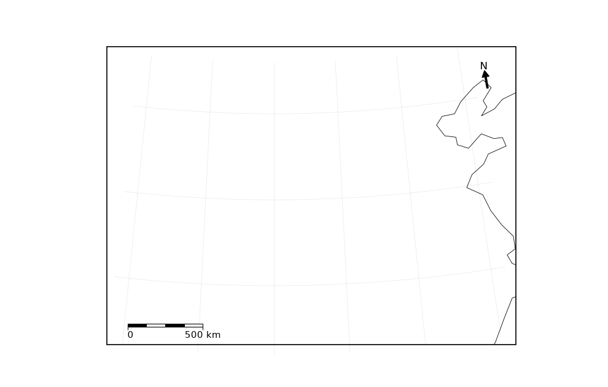

# Cookbook

Short, runnable recipes. Each assumes:

```python
import matplotlib
matplotlib.use("Agg")
import matplotlib.pyplot as plt
import mapelements

CRS = mapelements.CN_ALBERS
mapelements.pub_style()
```

## 1. Provincial map from a GeoDataFrame

```python
fig, ax = mapelements.figure("double", 110)
gdf.to_crs(CRS).plot(ax=ax, column="value", cmap="YlGnBu",
                     edgecolor="0.3", linewidth=0.4,
                     legend=True,
                     legend_kwds={"shrink": 0.45, "pad": 0.02})
mapelements.finish(ax, crs=CRS, data=gdf, scalebar=500)
mapelements.save(fig, "Fig1")
```

If the automatic colour bar crowds the map, pass `legend=False` and add your own
`fig.colorbar(..., ax=ax, fraction=0.03, pad=0.02)` before `save()`.

## 2. Cartopy with coastlines

```python
import cartopy.crs as ccrs

proj = ccrs.AlbersEqualArea(central_longitude=105, standard_parallels=(25, 47))
fig = plt.figure(figsize=(6.7, 4.4))
ax = fig.add_subplot(111, projection=proj)
ax.set_extent([94, 121, 26, 43], crs=ccrs.PlateCarree())
ax.coastlines(resolution="110m", lw=0.4)

ax.add_artist(mapelements.ScaleBar(length="auto", crs=ax.projection,
                                   loc=(0.05, 0.07)))
ax.add_artist(mapelements.NorthArrow(crs=ax.projection))
mapelements.save(fig, "Fig2", outdir="figs")
```



## 3. Raster basemap, vector furniture

```python
ax.imshow(hillshade, extent=[x0, x1, y0, y1], cmap="gray", zorder=0)
gdf.to_crs(CRS).plot(ax=ax, facecolor="none", edgecolor="C3", lw=0.5)
mapelements.finish(ax, crs=CRS, data=gdf)
mapelements.save(fig, "Fig3", allow_images=True)   # the basemap is the one raster
```

Declare the basemap in the caption ("shaded relief at 90 m"), and keep
everything else vector.

## 4. Filled contours without a 40 MB PDF

```python
cf = ax.contourf(lon, lat, field, levels=20, transform=ccrs.PlateCarree())
cf.set_rasterized(True)     # the field only
mapelements.finish(ax, crs=ax.projection, extent=(94, 121, 26, 43))
mapelements.save(fig, "Fig4", allow_images=True)
```

Text, coastlines, graticule, scale bar and north arrow stay vector.

## 5. Two panels, one configuration

```python
fig, axs = plt.subplots(1, 2, figsize=(7.0, 3.2), constrained_layout=True)
sb = mapelements.ScaleBar(length=500, crs=CRS, loc=(0.06, 0.08))
nw = mapelements.NorthArrow(crs=CRS)

for ax, ext in zip(axs, [(94, 108, 26, 43), (108, 121, 26, 43)]):
    gdf.to_crs(CRS).plot(ax=ax, column="value")
    mapelements.finish(ax, crs=CRS, extent=ext, fill=False,
                       graticule=5, scalebar=None, north=None)
    ax.add_artist(sb.copy())
    ax.add_artist(nw.copy())

mapelements.save(fig, "Fig5", formats=("pdf",))
```

## 6. Recolour an element after adding it

```python
sb = mapelements.scale_bar(ax, length=500, crs=CRS)
sb.colors = ("0.15", "white")
sb.fontsize = 6.5
sb.loc = (0.55, 0.06)
fig.canvas.draw()          # geometry is rebuilt on every draw
```

## 7. Move the furniture for a particular layout

```python
mapelements.ScaleBar(length=500, crs=CRS, loc=(0.62, 0.05))
mapelements.NorthArrow(crs=CRS, loc=(0.90, 0.60))
```

Positions are axes fractions: `(0, 0)` is lower-left, `(1, 1)` upper-right.

## 8. Chinese labels

```python
mapelements.pub_style({"font.sans-serif": ["Microsoft YaHei", "SimHei",
                                           "Arial", "DejaVu Sans"]})
ax.set_xlabel("经度 (°E)")
ax.set_ylabel("纬度 (°N)")
```

Check the result in Illustrator before submitting: CID-encoded CJK text is
editable but depends on the editor having the font. See
[Exporting for a journal](export.md#delivering-ai-emf-word-ppt).

## 9. Submission package

```python
for i, fig in enumerate(figures, start=1):
    mapelements.save(fig, f"Fig{i}", outdir="submission",
                     formats=("pdf", "png"))
```

One PDF per figure number, plus a PNG preview for the reviewer system; the SVG
can be regenerated on demand.
