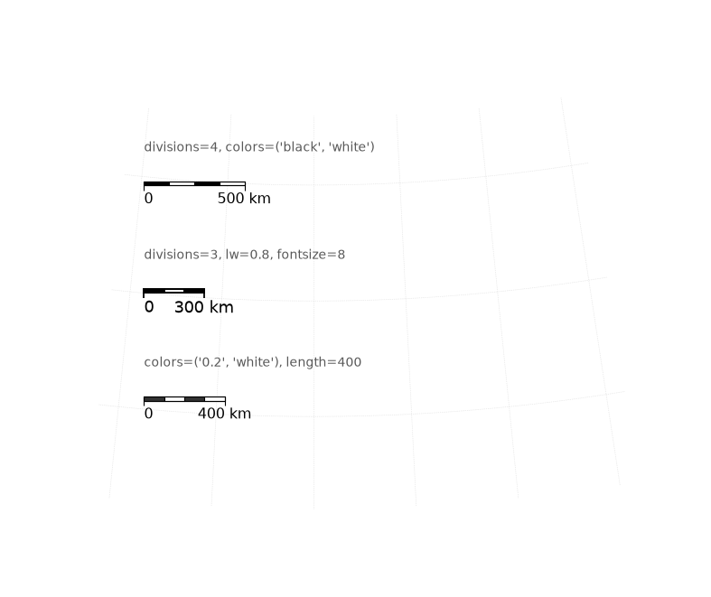
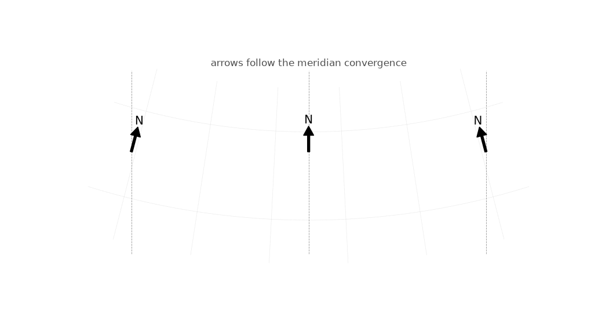
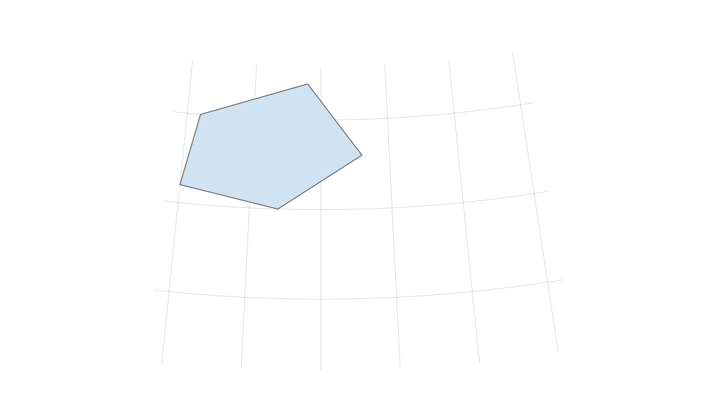

# Map elements

Three `Artist` subclasses. Add them with `ax.add_artist(...)`, remove them with
`.remove()`, duplicate them with `.copy()`.

All of them rebuild their geometry at draw time, from the current axis limits
and figure size. You may therefore add them before or after `set_xlim()`; the
result is identical.

## ScaleBar

```python
from mapelements import ScaleBar
ax.add_artist(ScaleBar(length=500, crs=CRS, loc=(0.05, 0.06)))
```

```python
ScaleBar(
    length="auto",           # distance in km, or "auto"
    crs=None,                # projection; defaults to ax.projection
    loc=(0.05, 0.06),        # lower-left corner, axes fraction
    height_frac=0.010,       # bar height, fraction of the axis height
    divisions=4,             # number of blocks
    colors=("black", "white"),  # cycled across blocks
    lw=0.5,                  # outline width, points
    fontsize=7,              # label size, points
    unit_label="km",         # appended to the last label
    show_mid=False,          # also label the middle value
    ref_lon=None, ref_lat=None,  # reference point for the geodesic
    zorder=30,
)
```

### How the length is computed

The bar is not "500 km worth of projected units". At the bar's own position the
code computes the geodesic distance of a 1 km step due east, projects both
endpoints, and takes the horizontal component:

```text
lon2, lat2 = geod.fwd(ref_lon, ref_lat, azimuth=90, distance=500 km)
width_frac = |x(lon2, lat2) - x(ref_lon, ref_lat)| / (xlim_max - xlim_min)
```

This cancels the projection's scale factor automatically, so the same code is
correct in Albers, Lambert, UTM or any other projected CRS. The reference point
defaults to the bar's own position; override `ref_lon`/`ref_lat` only if you
want the bar calibrated at a different latitude.

Because the bar is drawn horizontally, it represents east–west distance at its
own latitude. This is the usual cartographic convention; mention the reference
latitude in the caption if the map spans a very large latitude range.

### `length="auto"`

`auto` takes 18 % of the map width and snaps it to a 1/2/5 × 10ⁿ value
(473 km → 500 km). The resolved value is stored on the artist:

```python
sb = ScaleBar(length="auto", crs=CRS)
ax.add_artist(sb)
fig.canvas.draw()
print(sb.resolved_length)   # 500.0
```

### Styling

```python
# three divisions, 0.8 pt outline, larger labels, mid label shown
ScaleBar(length=300, crs=CRS, divisions=3, lw=0.8, fontsize=8, show_mid=True)

# inverted colours
ScaleBar(length=500, crs=CRS, colors=("white", "black"))

# thinner, lower
ScaleBar(length=500, crs=CRS, height_frac=0.007, loc=(0.06, 0.04))
```



Labels are always `0` and the full value; `show_mid` adds the midpoint. The
unit label is appended to the last label, so the bar reads `0 … 500 km` without
a separate floating "km".

## NorthArrow

```python
from mapelements import NorthArrow
ax.add_artist(NorthArrow(crs=CRS, loc="upper right"))
```

```python
NorthArrow(
    crs=None,              # projection; defaults to ax.projection
    loc="upper right",     # alias or (fx, fy)
    length_pts=14,         # arrow length in points
    lw=0.6,
    fontsize=8,
    label="N",
    weight="normal",       # "bold" if your font has a bold face
    lon=None, lat=None,    # point where true north is evaluated
    zorder=30,
)
```

### True north, not "up"

On a conic projection the meridians converge, so north is not the vertical
direction everywhere. The arrow evaluates the geodesic direction due north at
its own position and rotates accordingly:

```text
theta = atan2(x(lon, lat+Δ) - x(lon, lat), y(lon, lat+Δ) - y(lon, lat))
```

At the edges of a 105°E Albers map the arrow leans by several degrees, which is
correct and visible in print.

Position aliases:

| `loc` | axes fraction |
|---|---|
| `"upper right"` | (0.93, 0.86) |
| `"upper left"` | (0.07, 0.86) |
| `"lower right"` | (0.93, 0.10) |
| `"lower left"` | (0.07, 0.10) |

Any tuple works too: `loc=(0.88, 0.75)`.



## Graticule

```python
from mapelements import Graticule
ax.add_artist(Graticule(crs=CRS, extent=(94, 121, 26, 43), step=5))
```

```python
Graticule(
    crs=None,
    extent=(lon0, lon1, lat0, lat1),   # required, in degrees
    step=5.0,                          # degrees between lines
    color="0.55",
    lw=0.35,
    ls=":",                            # passed to LineCollection
    npts=120,                          # samples per line
    zorder=1,                          # keep below your data
)
```

Meridians and parallels are sampled in lon/lat and reprojected into the map CRS,
so they curve correctly on conic projections. The whole grid is a single
`LineCollection`, which keeps the file small.

`extent` is independent of the axis limits: it controls which lines are drawn.
Pass a slightly smaller box than the axis if you want the grid to stop short of
the frame.



## Sharing one configuration across panels

```python
sb = ScaleBar(length=500, crs=CRS)
nw = NorthArrow(crs=CRS)

for ax in axs.flat:
    ax.add_artist(sb.copy())
    ax.add_artist(nw.copy())
```

Each copy resolves its own length and rotation from its own axis, while the
styling stays identical. Do not reuse the same artist object on two axes —
matplotlib forbids it.
