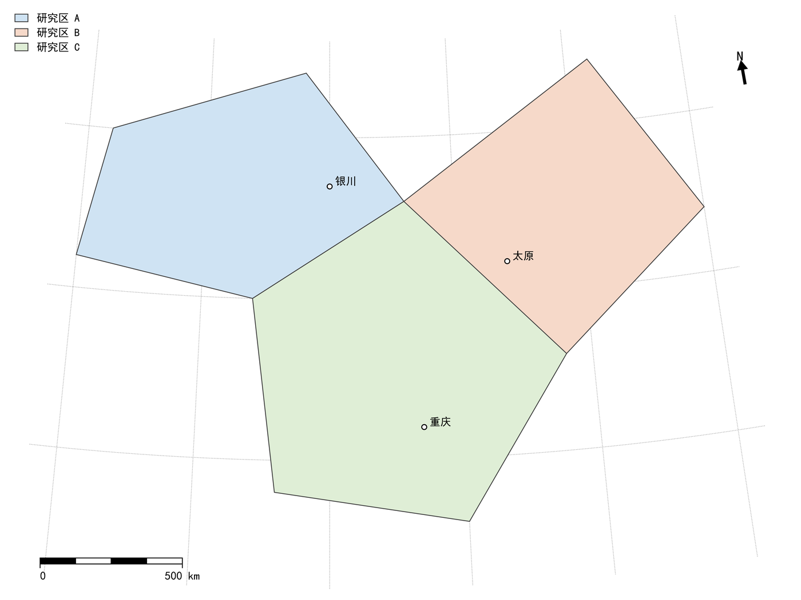

# mapelements

**Vector map elements for matplotlib — scale bars, north arrows and graticules
that stay editable in PDF and SVG.**

## Why this package exists

Many journals ask for vector artwork with *editable text*: the editor wants to
open the figure in Illustrator and change a label, a colour or a line width.
Matplotlib can produce such files, but the three elements every map needs —
a scale bar, a north arrow, a graticule — are not part of it. The packages that
do provide them either rasterise the result (`matplotlib_map_utils` renders the
whole scale bar into an `OffsetImage`) or cover only one element.

`mapelements` builds all three from `Patch`, `Line2D` and `Text`. Nothing is
rasterised, so the exported PDF contains no image objects and the SVG contains
`<text>` elements.



## What you get

| Element | Class | Highlights |
|---|---|---|
| Scale bar | `ScaleBar` | geodesic length at the bar's own latitude, automatic 1/2/5 rounding, alternating black/white blocks |
| North arrow | `NorthArrow` | points to true north using the projection's meridian convergence |
| Graticule | `Graticule` | lon/lat grid reprojected into the map CRS, one `LineCollection` |
| One-call helper | `finish()` | extent + graticule + scale bar + north arrow |
| Layout helper | `fit()` | removes subplot margins, keeps the data aspect ratio |
| Export + check | `save()`, `check_vector()` | writes PDF/SVG/PNG and refuses to ship Type-3 or bitmap output |

## Install

```bash
pip install mapelements
```

## Three ways to use it

```python
# 1) Artist style — same as any matplotlib artist
from mapelements import ScaleBar, NorthArrow, Graticule
ax.add_artist(ScaleBar(length=500, crs=CRS))
ax.add_artist(NorthArrow(crs=CRS, loc="upper right"))
```

```python
# 2) Function style — adds and returns the artist
mapelements.scale_bar(ax, length=500, crs=CRS)
```

```python
# 3) One call for the whole map furniture
mapelements.finish(ax, crs=CRS, data=gdf)
mapelements.save(fig, "Fig1")
```

## Next steps

1. [Installation](installation.md)
2. [Quickstart](quickstart.md)
3. [Map elements](elements.md)
4. [Exporting for a journal](export.md)

## Requirements

- Python ≥ 3.9
- matplotlib ≥ 3.6, numpy, pyproj
- optional: geopandas (`[geo]`), cartopy (`[cartopy]`)

## License

MIT.
