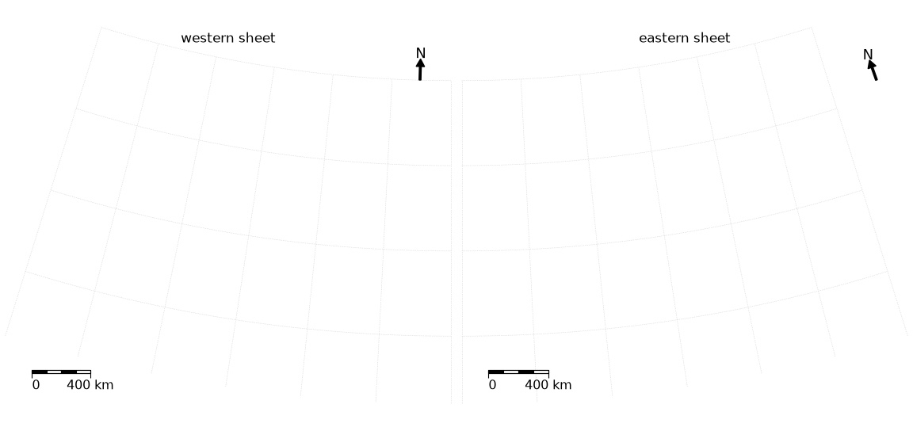

# Layout and typography

## Figure sizes in millimetres

```python
fig, ax = mapelements.figure("single", 70)    # 85 mm wide
fig, ax = mapelements.figure("double", 110)   # 170 mm wide
fig, ax = mapelements.figure(120, 80)         # custom width
```

Font sizes are in points, so they only mean something once the figure has its
final printed width. Decide the width first, then set type sizes:

| Element | Typical size |
|---|---|
| Tick labels, legend, scale bar | 6.5–7 pt |
| Axis labels, annotations | 7–8 pt |
| Panel letters (a, b, c) | 8 pt, bold |
| Line widths | 0.4–0.8 pt |

`pub_style()` already applies these defaults.

## Filling the canvas

By default matplotlib leaves subplot margins. For a single map you usually want
none:

```python
mapelements.finish(ax, crs=CRS, data=gdf)     # fill=True by default
```

`fit()` sets the axes to `[0, 0, 1, 1]` and adjusts the figure height to the
data aspect ratio, so the map touches all four edges. It only acts when the
figure contains exactly one axes; multi-panel figures are left alone.

Call it explicitly when you build the axes yourself:

```python
ax.set_xlim(x0, x1); ax.set_ylim(y0, y1); ax.set_aspect("equal")
mapelements.fit(ax)
```

## Multi-panel figures

```python
fig, axs = plt.subplots(1, 2, figsize=(7.0, 3.2), constrained_layout=True)
for ax, extent in zip(axs, [(94, 108, 26, 43), (108, 121, 26, 43)]):
    gdf.to_crs(CRS).plot(ax=ax)
    mapelements.finish(ax, crs=CRS, extent=extent, fill=False)
```

- `fill=False` keeps your grid layout intact.
- Share one scale bar configuration with `.copy()`, see
  [Map elements](elements.md#sharing-one-configuration-across-panels).
- Give each panel the same extent when the panels are comparable; different
  extents with the same scale bar invite misreading.



## Legends

`finish(legend=True)` places a borderless legend in the upper left, inset by
1.2 % of the axes:

```python
handles = [Patch(facecolor=c, edgecolor="0.25", lw=0.5, label=n)
           for c, n in zip(colors, labels)]
ax.legend(handles=handles, loc="upper left", fontsize=6.5,
          frameon=False, handlelength=1.2)
```

For categorical maps, build the legend yourself: `legend=True` only repositions
an existing one.

## Fonts

```python
mapelements.pub_style({
    "font.sans-serif": ["Arial", "Helvetica", "DejaVu Sans"],
    "font.size": 8,
})
```

- Prefer Arial / Helvetica for Latin text. They are present on virtually every
  editorial workstation, so the PDF renders identically after transfer.
- For Chinese labels add a CJK font that exists on the editor's machine:
  `"Microsoft YaHei"`, `"SimHei"`, `"Noto Sans CJK SC"`.
- If you can, put Chinese in the caption and keep the artwork labels in English.
  It removes an entire class of missing-font problems and is accepted by most
  journals.

matplotlib warns `findfont: Failed to find font weight bold` when the only
installed CJK font has no bold face. Either set `weight="normal"` on
`NorthArrow` or install a family with a bold weight.

## Colour and aspect

- `ax.set_aspect("equal")` is mandatory; `finish()` and `fit()` assume it.
- Leave `savefig.bbox` at `"standard"`, i.e. do not pass `bbox_inches="tight"`:
  the exported size must match the size you reserved in the manuscript.
- Avoid `transparent=True`; journals expect a white page.
