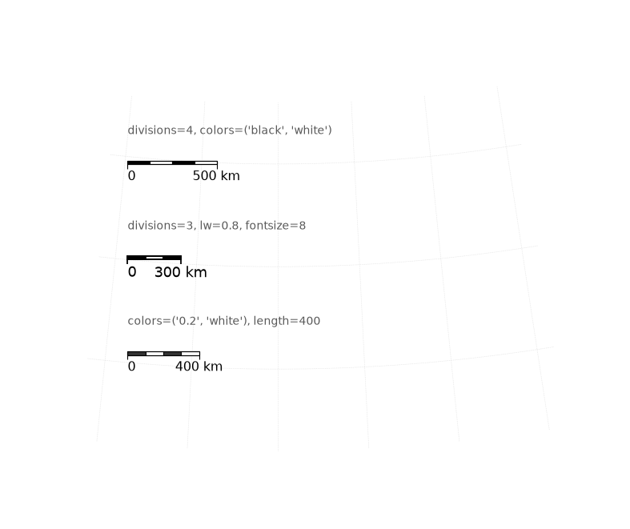
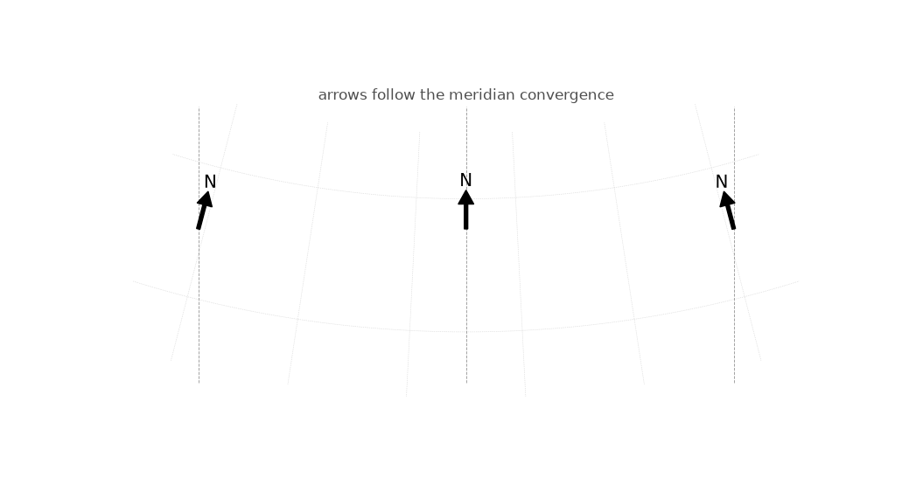
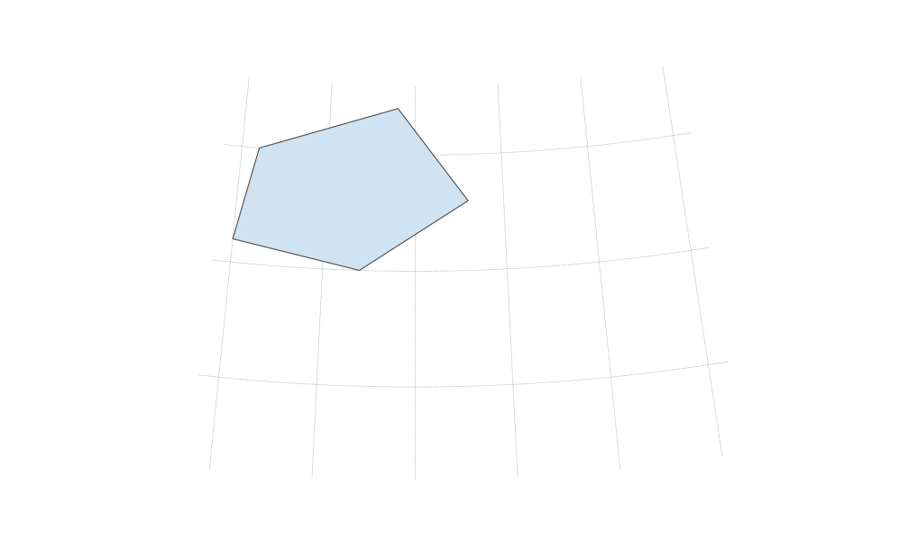

# 地图要素

三个 `Artist` 子类。用 `ax.add_artist(...)` 添加，用 `.remove()` 移除，
用 `.copy()` 复制到别的子图。

它们在**绘制时**才根据当前坐标范围和画布尺寸重建几何，所以先 `add_artist`
再 `set_xlim`，和反过来，结果完全一样。

## 比例尺 `ScaleBar`

```python
from mapelements import ScaleBar
ax.add_artist(ScaleBar(length=500, crs=CRS, loc=(0.05, 0.06)))
```

```python
ScaleBar(
    length="auto",           # 公里数，或 "auto"
    crs=None,                # 投影；默认取 ax.projection
    loc=(0.05, 0.06),        # 左下角位置，axes fraction
    height_frac=0.010,       # 条高，占轴高的比例
    divisions=4,             # 分段数
    colors=("black", "white"),  # 按段循环
    lw=0.5,                  # 外框线宽，pt
    fontsize=7,              # 标签字号，pt
    unit_label="km",         # 追加到最后一个标签
    show_mid=False,          # 是否标出中值
    ref_lon=None, ref_lat=None,  # 测地线参考点
    zorder=30,
)
```

### 长度是怎么算的

不是“500 km 直接换算成投影单位”，而是在比例尺所在位置，取正东方向 1 km 的
测地线，把两端投影后取水平分量：

```text
lon2, lat2 = geod.fwd(ref_lon, ref_lat, azimuth=90, distance=500 km)
width_frac = |x(lon2, lat2) - x(ref_lon, ref_lat)| / (xlim_max - xlim_min)
```

投影的尺度因子被自动消掉，所以同一套代码在 Albers、Lambert、UTM 下都正确。
参考点默认就是比例尺自身的位置；只有想换一个纬度标定时才需要显式给
`ref_lon`/`ref_lat`。

因为条是水平画的，它代表的是**该纬度上的东西向距离**，这也是制图惯例；
图幅跨纬度很大时，在图注里说明参考纬度即可。

### `length="auto"`

取图宽的 18%，再向上取整到 1/2/5×10ⁿ（473 km → 500 km）。解析结果保存在 artist 上：

```python
sb = ScaleBar(length="auto", crs=CRS)
ax.add_artist(sb)
fig.canvas.draw()
print(sb.resolved_length)   # 500.0
```

### 样式

```python
# 三段、0.8 pt 外框、大一点的字、标出中值
ScaleBar(length=300, crs=CRS, divisions=3, lw=0.8, fontsize=8, show_mid=True)

# 反色
ScaleBar(length=500, crs=CRS, colors=("white", "black"))

# 更矮、更靠下
ScaleBar(length=500, crs=CRS, height_frac=0.007, loc=(0.06, 0.04))
```



标签默认是 `0` 和全长；`show_mid=True` 时加上中值。单位是追加在最后一个标签后的，
所以读起来是 `0 … 500 km`，不会有单独飘着的 "km"。

## 指北针 `NorthArrow`

```python
from mapelements import NorthArrow
ax.add_artist(NorthArrow(crs=CRS, loc="upper right"))
```

```python
NorthArrow(
    crs=None,              # 投影；默认取 ax.projection
    loc="upper right",     # 别名或 (fx, fy)
    length_pts=14,         # 箭头长度，pt
    lw=0.6,
    fontsize=8,
    label="N",
    weight="normal",       # 字体有粗体时可设 "bold"
    lon=None, lat=None,    # 计算真北的位置
    zorder=30,
)
```

### 是真北，不是“朝上”

锥形投影的经线是收敛的，北向并不处处竖直。箭头在自身位置沿经线取 1 km 的测地线，
据此旋转：

```text
theta = atan2(x(lon, lat+Δ) - x(lon, lat), y(lon, lat+Δ) - y(lon, lat))
```

在 105°E 的 Albers 图幅边缘，箭头会偏几度——这是对的，印刷出来也看得出来。

位置别名：

| `loc` | axes fraction |
|---|---|
| `"upper right"` | (0.93, 0.86) |
| `"upper left"` | (0.07, 0.86) |
| `"lower right"` | (0.93, 0.10) |
| `"lower left"` | (0.07, 0.10) |

也可以直接给元组：`loc=(0.88, 0.75)`。



## 经纬网 `Graticule`

```python
from mapelements import Graticule
ax.add_artist(Graticule(crs=CRS, extent=(94, 121, 26, 43), step=5))
```

```python
Graticule(
    crs=None,
    extent=(lon0, lon1, lat0, lat1),   # 必填，经纬度
    step=5.0,                          # 间隔（度）
    color="0.55",
    lw=0.35,
    ls=":",                            # 传给 LineCollection
    npts=120,                          # 每条线的采样点数
    zorder=1,                          # 压在数据下面
)
```

经线和纬线都在经纬度上采样后重投影，所以锥形投影下会正确弯曲。整张网是一个
`LineCollection`，文件很小。

`extent` 与坐标轴范围无关：它决定画哪些线。想让网格不顶到边框，就把这个框
取得比轴范围略小一点。



## 多子图共用一套配置

```python
sb = ScaleBar(length=500, crs=CRS)
nw = NorthArrow(crs=CRS)

for ax in axs.flat:
    ax.add_artist(sb.copy())
    ax.add_artist(nw.copy())
```

每个副本会按各自子图的范围重新计算长度和方向，样式保持一致。同一个 artist 对象
不要往两个 Axes 上加，matplotlib 不允许。
