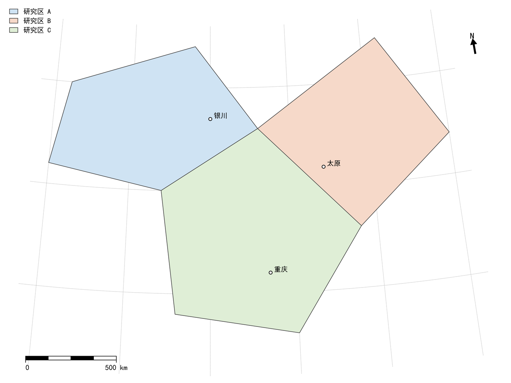

# mapelements

**matplotlib 的矢量地图要素 —— 比例尺、指北针、经纬网，导出 PDF/SVG 后文字仍可修改。**

## 为什么需要这个包

很多期刊要求图件是矢量，且**图中文字可修改**：编辑要能在 Illustrator 里直接改标签、
改颜色、改线宽。matplotlib 本身能产出这种文件，但每张地图都需要的三样东西——
比例尺、指北针、经纬网——它没有。现有的包要么把结果栅格化
（`matplotlib_map_utils` 会把整条比例尺渲染成 `OffsetImage`），要么只覆盖其中一项。

`mapelements` 用 `Patch`、`Line2D`、`Text` 画出这三样东西，不做任何栅格化：
导出的 PDF 里没有图像对象，SVG 里是真正的 `<text>`。



## 你能得到什么

| 要素 | 类 | 特点 |
|---|---|---|
| 比例尺 | `ScaleBar` | 按自身纬度取测地线长度，自动取整到 1/2/5×10ⁿ，黑白交替分段 |
| 指北针 | `NorthArrow` | 按投影的经线收敛角指向真北，不是简单朝上 |
| 经纬网 | `Graticule` | 经纬度网格重投影到地图坐标系，整张网是一个 `LineCollection` |
| 一站式收尾 | `finish()` | 范围 + 经纬网 + 比例尺 + 指北针 |
| 版式辅助 | `fit()` | 去掉 subplot 留白，保持数据纵横比 |
| 导出与自检 | `save()`、`check_vector()` | 输出 PDF/SVG/PNG，并拒绝 Type 3 或位图结果 |

## 安装

```bash
pip install mapelements
```

## 三种用法

```python
# 1) Artist 方式 —— 和普通 matplotlib artist 完全一样
from mapelements import ScaleBar, NorthArrow, Graticule
ax.add_artist(ScaleBar(length=500, crs=CRS))
ax.add_artist(NorthArrow(crs=CRS, loc="upper right"))
```

```python
# 2) 函数方式 —— 添加并返回 artist
mapelements.scale_bar(ax, length=500, crs=CRS)
```

```python
# 3) 一行搞定地图要素
mapelements.finish(ax, crs=CRS, data=gdf)
mapelements.save(fig, "Fig1")
```

## 接下来

1. [安装](installation.md)
2. [快速开始](quickstart.md)
3. [地图要素](elements.md)
4. [投稿导出](export.md)

## 环境要求

- Python ≥ 3.9
- matplotlib ≥ 3.6、numpy、pyproj
- 可选：geopandas（`[geo]`）、cartopy（`[cartopy]`）

## 许可证

MIT。
