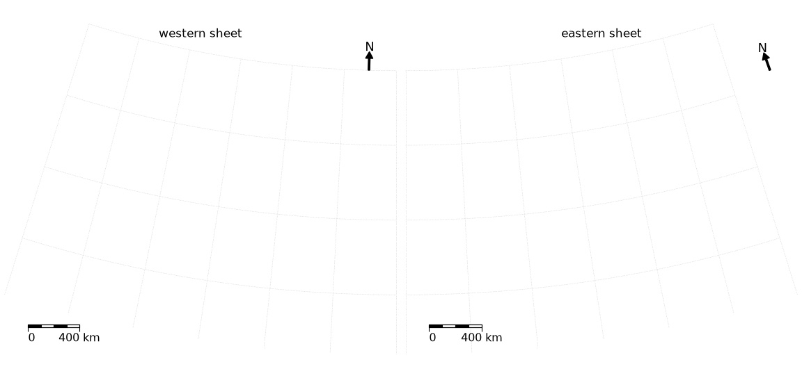

# 版式与字体

## 按毫米建图

```python
fig, ax = mapelements.figure("single", 70)    # 85 mm 宽
fig, ax = mapelements.figure("double", 110)   # 170 mm 宽
fig, ax = mapelements.figure(120, 80)         # 自定义宽度
```

字号以 pt 计，只有在图件按最终印刷宽度输出时才有意义。先定宽度，再定字号：

| 元素 | 常用字号 |
|---|---|
| 刻度、图例、比例尺 | 6.5–7 pt |
| 轴标题、注记 | 7–8 pt |
| 子图字母（a、b、c） | 8 pt，加粗 |
| 线宽 | 0.4–0.8 pt |

`pub_style()` 已经内置了这套默认值。

## 铺满画布

matplotlib 默认会留 subplot 边距，单幅地图通常不需要：

```python
mapelements.finish(ax, crs=CRS, data=gdf)     # 默认 fill=True
```

`fit()` 会把轴设为 `[0, 0, 1, 1]`，再按数据纵横比调整画布高度，让地图顶到四条边。
它只在“一个 figure 只有一个 Axes”时生效，多子图保持原样。

自己建轴时可以显式调用：

```python
ax.set_xlim(x0, x1); ax.set_ylim(y0, y1); ax.set_aspect("equal")
mapelements.fit(ax)
```

## 多子图

```python
fig, axs = plt.subplots(1, 2, figsize=(7.0, 3.2), constrained_layout=True)
for ax, extent in zip(axs, [(94, 108, 26, 43), (108, 121, 26, 43)]):
    gdf.to_crs(CRS).plot(ax=ax)
    mapelements.finish(ax, crs=CRS, extent=extent, fill=False)
```

- `fill=False` 保住你的网格布局。
- 一套配置用 `.copy()` 分发，见[地图要素](elements.md#多子图共用一套配置)。
- 可比的子图要给相同范围；范围不同却共用同一个比例尺，会让人误读。



## 图例

`finish(legend=True)` 会在左上角放一个无边框图例，内缩 1.2%：

```python
handles = [Patch(facecolor=c, edgecolor="0.25", lw=0.5, label=n)
           for c, n in zip(colors, labels)]
ax.legend(handles=handles, loc="upper left", fontsize=6.5,
          frameon=False, handlelength=1.2)
```

分类图建议自己搭图例：`legend=True` 只是调整已有图例的位置。

## 字体

```python
mapelements.pub_style({
    "font.sans-serif": ["Arial", "Helvetica", "DejaVu Sans"],
    "font.size": 8,
})
```

- 西文优先 Arial / Helvetica：几乎每台编辑工作站都有，PDF 传过去渲染一致。
- 中文标签要选编辑端大概率装有的字体：`"Microsoft YaHei"`、`"SimHei"`、
  `"Noto Sans CJK SC"`。
- 能的话，图内用英文、中文放图注。这样能绕开一整类缺字体问题，多数期刊也接受。

当机器上唯一的中文字体没有粗体时，matplotlib 会警告
`findfont: Failed to find font weight bold`。把 `NorthArrow` 的 `weight` 设为
`"normal"`，或安装带粗体的字族即可。

## 颜色与比例

- `ax.set_aspect("equal")` 是必须的；`finish()` 和 `fit()` 都基于它。
- `savefig.bbox` 保持 `"standard"`，不要传 `bbox_inches="tight"`：
  导出尺寸必须和你在正文里预留的位置一致。
- 不要用 `transparent=True`，期刊期待白底。
